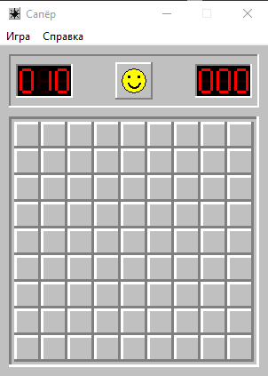

# Сапёр — Rust Edition [](https://github.com/yummyactually/rust-sweeper/actions/workflows/ci.yml)

[**Скачать последний релиз →**](https://github.com/yummyactually/rust-sweeper/releases/latest)

Классический Windows Minesweeper, написанный на Rust: нативное окно Win32, GDI-графика, меню, LED-счётчики, жёлтый смайлик и узнаваемое поле с объёмными клетками. Без внешних Rust-крейтов; CRT статически встроен.



## Скачать

Готовые сборки для Windows x64 публикуются в [GitHub Releases](https://github.com/yummyactually/rust-sweeper/releases/latest) и создаются CI/CD для тегов `v*`.

| Файл | Назначение |
| --- | --- |
| `minesweeper-windows-x64.zip` | Архив с игрой, README и LICENSE |
| `minesweeper.exe` | Готовый исполняемый файл |
| `SHA256SUMS.txt` | Контрольная сумма SHA-256 |

Для запуска достаточно Windows 10/11 x64. Microsoft Visual C++ Redistributable и `VCRUNTIME140.dll` не требуются.

## Возможности

- Классическое серое окно, объёмные клетки и нативные меню `Игра` / `Справка`;
- Три уровня сложности: `Новичок`, `Любитель` и `Эксперт`;
- Безопасный первый клик и каскадное открытие пустых клеток;
- Флаги, вопросительные знаки и chord;
- 7-сегментные LED-счётчики, таймер и жёлтый смайлик;
- Статический CRT, отсутствие внешних Rust-крейтов и один EXE.

## Управление

| Действие | Управление |
| --- | --- |
| Открыть клетку | Левый клик |
| Открыть соседей по цифре | Левый клик по открытой цифре или средний клик |
| Флаг или вопросительный знак | Правый клик; цикл включается через `Отметка (?)` |
| Новая игра | Смайлик, `Новая игра`, `F2` или `R` |
| Сменить сложность | Меню `Игра` → `Новичок` / `Любитель` / `Эксперт` |
| Включить или отключить вопросительные знаки | Меню `Игра` → `Отметка (?)` |
| Справка | Меню `Справка` → `О программе` |
| Выход | `Esc` или меню `Игра` → `Выход` |

## Сборка из исходников

Нужны Windows 10/11 x64, Rust stable MSVC и Visual Studio 2022 Build Tools с рабочей нагрузкой `Desktop development with C++`.
Скрипты сами находят `vcvars64.bat` и `%USERPROFILE%\.cargo\bin`.

```powershell
.\scripts\test.ps1
.\scripts\build.ps1
.\scripts\package.ps1
.\scripts\smoke.ps1
```

Результат упаковки — `dist\minesweeper.exe`.

## CI/CD

GitHub Actions на каждый push и pull request запускает форматирование, тесты, clippy, релизную сборку, упаковку и smoke-тест. Тег `v*` публикует `minesweeper-windows-x64.zip`, `minesweeper.exe` и `SHA256SUMS.txt` в GitHub Releases.

## Структура проекта

```text
src/game.rs    игровой движок
src/app.rs     классический интерфейс и отрисовка
src/win32.rs   окно Win32, меню и GDI
scripts/       сборка, тесты, упаковка и smoke
assets/       скриншот интерфейса
```

## Лицензия

MIT. См. [LICENSE](LICENSE).

---

RUST EPIDEMY
